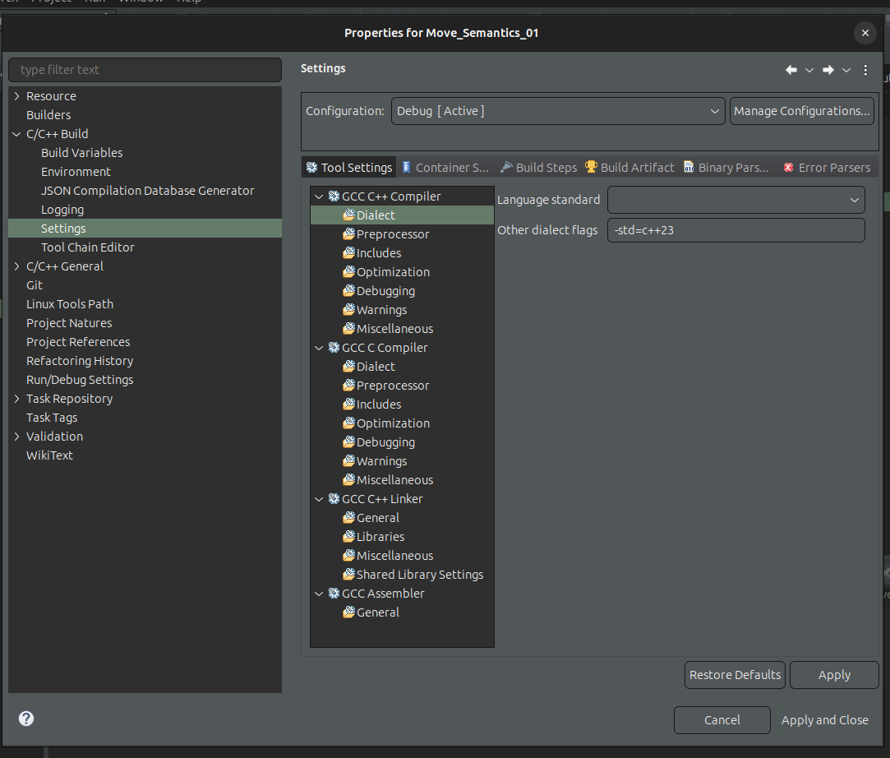

# C++ Fundamentals Learning Repository

## Description

This repository contains my learning journey and exploration of fundamental concepts in C++.

## Table of Contents

- [C++ Fundamentals Learning Repository](#c-fundamentals-learning-repository)
  - [Description](#description)
  - [Table of Contents](#table-of-contents)
  - [Repo Structure](#repo-structure)
  - [Building](#building)
    - [Support for Modern C++ in Eclipse](#support-for-modern-c-in-eclipse)
    - [Check Compiler version](#check-compiler-version)
  - [Resources](#resources)
    - [Youtube Channels](#youtube-channels)
    - [Web Resources](#web-resources)
    - [More Formal Resources](#more-formal-resources)

## Repo Structure

- Each directory focuses on a specific idea or concept in C++.
- Examples include object-oriented programming, pointers, templates, inheritance, and more.

## Building

I use [Eclipse IDE](https://eclipseide.org/) as my dev tool to build and run 
C++ programs.
- see [C/C++ dev user guide](https://help.eclipse.org/latest/index.jsp)
- the projects are run and build using default build in system provided by Eclipse
under Linux

- I plan to explore CMake for build automation in the future.

### Support for Modern C++ in Eclipse

To support modern C++ like `C++23` for example for a certain project,
riight click on project properties, than

<pre>C/C++ Build → Settings → GCC C++ Compiler → Dialect</pre>

Then we add the flag `std=c++23` as shown in [Figure 1](#fig1)

<strong>Figure 1:</strong> Configuring C++23 in Eclipse

### Check Compiler version

Check the active version of `g++` with

<pre>g++ --version</pre>

## Resources

### Youtube Channels

These youtube channels are more pedagogical and user friendly then official resources.

- [The Cherno](https://www.youtube.com/@TheCherno)
  - contains also its series about Hazel game engine
- [PortfolioCourses](https://www.youtube.com/@PortfolioCourses)
- [ProfessorHankStalica](https://www.youtube.com/@ProfessorHankStalica)
- [MikeShah](https://www.youtube.com/@MikeShah)
  - Nice content about graphic and games programming
- [CodeBeauty](https://www.youtube.com/@CodeBeauty)
- [Andreas Fertig](https://www.youtube.com/@andreas_fertig)
  - Nice playlist, highlighting features and what is happening behind the sceens

### Web Resources

- [studyplan](https://www.studyplan.dev/)
  - nicely structured, and organized for each topic with some samples code
    - and straightforward
  - also some gamedev using SDL

### More Formal Resources

- [C++ Reference](https://en.cppreference.com/)
- [LearnCpp](https://www.learncpp.com/)
- [C++ Language Tutorial](https://www.cplusplus.com/doc/tutorial/)
- [ISO C++](https://isocpp.org/)
