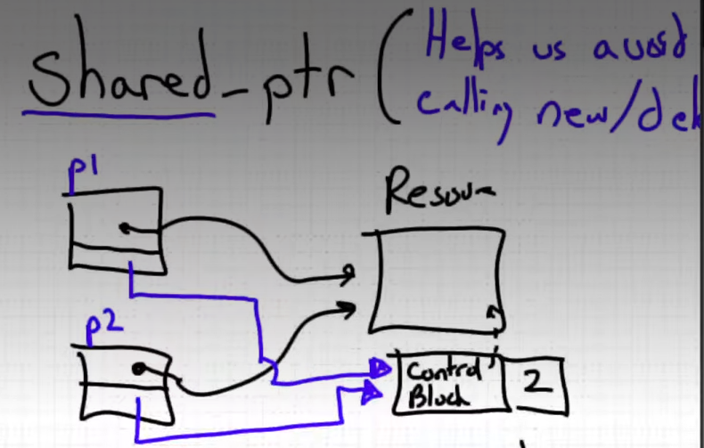

# Smart Pointers

Smart pointers are objects that manage dynamically allocated resources. They help
release memory automatically when ownership ends, following the C++ RAII pattern.
The examples in this document use the standard library types in `<memory>`.

## Table of contents

- [Unique pointers (`std::unique_ptr`)](#unique-pointers-stdunique_ptr)
- [Shared pointers (`std::shared_ptr`)](#shared-pointers-stdshared_ptr)
- [Weak pointers (`std::weak_ptr`)](#weak-pointers-stdweak_ptr)
- [Running the project example](#running-the-project-example)

## Unique pointers (`std::unique_ptr`)

A `std::unique_ptr` has exclusive ownership of its resource: it cannot be copied
to create another owner. Ownership can be transferred with `std::move`; after
the move, the source pointer is empty. The resource is released automatically
when its owning pointer is destroyed or reset.

Use `std::make_unique` to create a unique pointer. For an array, use the array
form `std::unique_ptr<T[]>` and `std::make_unique<T[]>(size)`.

```cpp
#include <iostream>
#include <memory>

int main() {
    auto first = std::make_unique<int>(42);
    auto second = std::move(first);

    std::cout << "first is empty: " << std::boolalpha << (first == nullptr)
              << '\n';
    std::cout << "second owns: " << *second << '\n';
}
```

Output:

```text
first is empty: true
second owns: 42
```

The project example also creates an array of three `UDT` objects:

```cpp
std::unique_ptr<UDT[]> x_arr = std::make_unique<UDT[]>(3);
```

Each array element is destroyed automatically when `x_arr` leaves scope.

## Shared pointers (`std::shared_ptr`)

Use `std::shared_ptr` when multiple owners need to keep one resource alive.
Copying a shared pointer adds an owner and increments the shared ownership
count. When a shared pointer is destroyed, its ownership is released; the
resource is destroyed after the last owning `shared_ptr` is gone.

`std::make_shared` is the recommended way to create a shared pointer. The
project example copies one owner into a nested scope and prints the ownership
count before and after that scope:

```cpp
#include <iostream>
#include <memory>

int main() {
    std::shared_ptr<int> first_owner = std::make_shared<int>(42);

    {
        std::shared_ptr<int> second_owner = first_owner;
        std::cout << "owners while both pointers are in scope = "
                  << first_owner.use_count() << '\n';
        std::cout << "owners reported by second pointer = "
                  << second_owner.use_count() << '\n';
    }

    std::cout << "owners after second pointer leaves scope = "
              << first_owner.use_count() << '\n';
}
```

Output:

```text
owners while both pointers are in scope = 2
owners reported by second pointer = 2
owners after second pointer leaves scope = 1
```

The project program prints the same counts with its own labels:

```text
UDT count using shared pointers (ptr 1) before scope = 2
UDT count using shared pointers (ptr 2) before scope = 2
UDT count using shared pointers after scope = 1
```

Both pointers report `2` while both own the object. When the second pointer
leaves scope, its ownership is released and the remaining pointer reports `1`.
`use_count()` is useful for observation and examples, but generally should not
be used to make program logic depend on the exact number of owners.

<div id="fig1">

<p><strong>Figure 1:</strong> Multiple shared pointers can own the same resource.</p>
</div>

## Weak pointers (`std::weak_ptr`)

A `std::weak_ptr` observes an object managed by `std::shared_ptr` without
becoming an owner. Creating or copying a weak pointer does not increase the
shared ownership count. This is useful when code needs to check whether a
shared resource still exists without extending its lifetime; weak pointers can
also help prevent ownership cycles between shared pointers.

To access the resource, call `lock()`. It returns a `std::shared_ptr` if the
resource is still alive, or an empty shared pointer if it has already been
destroyed. Check the returned pointer before using the resource:

```cpp
#include <iostream>
#include <memory>

int main() {
    std::weak_ptr<int> observer;

    {
        auto owner = std::make_shared<int>(42);
        observer = owner;

        if (auto locked = observer.lock()) {
            std::cout << "value: " << *locked << '\n';
            std::cout << "owners while locked: " << locked.use_count() << '\n';
        }
    }

    std::cout << "expired after owner leaves scope: "
              << std::boolalpha << observer.expired() << '\n';
    std::cout << "lock succeeds after expiration: "
              << static_cast<bool>(observer.lock()) << '\n';
}
```

Output:

```text
value: 42
owners while locked: 2
expired after owner leaves scope: true
lock succeeds after expiration: false
```

In this example, `locked` temporarily shares ownership with `owner`, so the
count is `2`. After both owning pointers are gone, the observer expires.

## Running the project example

From the `Smart_ptr` directory, compile and run the example with a C++23
compiler and standard library that provide `<print>` and `<format>`:

```sh
g++ -Wall -Wextra -std=c++23 main_smrt_ptr.cpp -o smart_ptr
./smart_ptr
```

The complete output from the current `main_smrt_ptr.cpp` run is:

```text
Default Constructor called
Default Constructor called
Default Constructor called
Default Constructor called
Default Constructor called
UDT count using shared pointers (ptr 1) before scope = 2
UDT count using shared pointers (ptr 2) before scope = 2
UDT count using shared pointers after scope = 1
Destructor called
Destructor called
Destructor called
Destructor called
Destructor called
```
